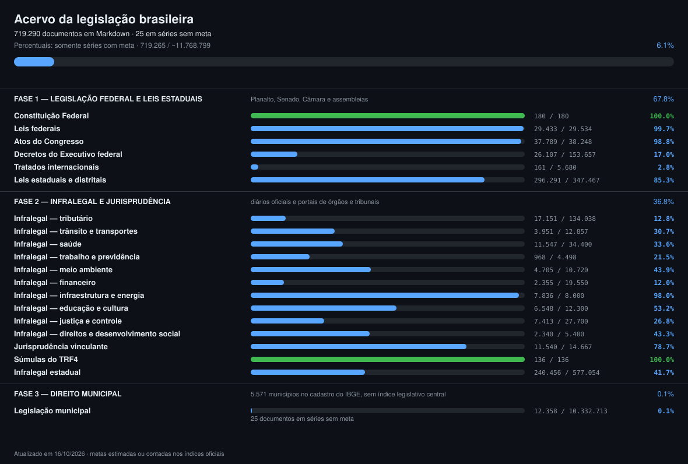

# Progresso

Gerado em 20/10/2026 18:54:42 (America/Recife). Escopo: `scripts/plano.py`.

Percentuais usam somente documentos e metas das séries com universo estimado ou contado. Séries sem meta ficam fora do cálculo. Volume não comprova integralidade das fontes ou qualidade das conversões.

**719.451 documentos · 719.426 / ~11.768.799 nas séries com meta (6.1%) · 25 sem meta**

## Fase 1 — legislação federal e leis estaduais

Planalto, Senado, Câmara e assembleias.

390.111 / ~574.766 documentos (67.9%)

### Constituição Federal

180 / ~180 documentos (100.0%)

| | Tipo de norma | Tem | Meta | Pasta | Fonte |
| :-: | --- | ---: | ---: | --- | --- |
| ✅ | Constituição de 1988 (texto vigente) | 1 | 1 | `constituicao.md` | https://www.planalto.gov.br |
| ✅ | Constituições históricas (1824, 1891, 1934, 1937, 1946, 1967, 1969) | 7 | 7 | `federal/constituicoes-historicas` | https://www.planalto.gov.br |
| ✅ | Emendas constitucionais e de revisão | 172 | 172 | `federal/emendas-constitucionais` | https://normas.leg.br |

### Leis federais

29.433 / ~29.534 documentos (99.7%)

| | Tipo de norma | Tem | Meta | Pasta | Fonte |
| :-: | --- | ---: | ---: | --- | --- |
| 🟦 | Leis ordinárias, numeradas e não numeradas (1822–hoje) | 16.784 | 16.883 | `federal/leis-ordinarias` | Senado (índice) + normas.leg.br (texto) |
| ✅ | Leis complementares | 239 | 239 | `federal/leis-complementares` | normas.leg.br |
| ✅ | Leis delegadas (série encerrada) | 13 | 13 | `federal/leis-delegadas` | normas.leg.br |
| ✅ | Leis constitucionais da Carta de 1937 (1938–1946) | 21 | 21 | `federal/leis-constitucionais` | https://www.planalto.gov.br/ccivil_03/LEIS/LCT/Quadro_Lct.htm |
| 🟦 | Decretos-leis (série encerrada em 1988) | 12.376 | 12.378 | `federal/decretos-lei` | normas.leg.br |

### Atos do Congresso

37.789 / ~38.248 documentos (98.8%)

| | Tipo de norma | Tem | Meta | Pasta | Fonte |
| :-: | --- | ---: | ---: | --- | --- |
| 🟦 | Decretos legislativos | 21.358 | 21.775 | `federal/decretos-legislativos` | normas.leg.br |
| 🟦 | Medidas provisórias (originais e reedições) | 7.488 | 7.497 | `federal/medidas-provisorias` | Planalto + normas.leg.br |
| 🟦 | Resoluções do Senado Federal | 6.572 | 6.578 | `federal/resolucoes-senado` | normas.leg.br |
| 🟦 | Resoluções da Câmara dos Deputados | 2.280 | 2.300 | `federal/resolucoes-camara` | camara.leg.br |
| 🟦 | Resoluções do Congresso Nacional e da Revisão Constitucional | 88 | 95 | `federal/resolucoes-congresso` | normas.leg.br |
| ✅ | Regimentos internos (Senado, Câmara, Congresso) | 3 | 3 | `federal/regimentos` | senado.leg.br, camara.leg.br |

### Decretos do Executivo federal

26.339 / ~153.657 documentos (17.1%)

| | Tipo de norma | Tem | Meta | Pasta | Fonte |
| :-: | --- | ---: | ---: | --- | --- |
| 🟦 | Decretos numerados (1889–hoje, as duas séries) | 11.812 | 139.127 | `federal/decretos` | normas.leg.br + Planalto |
| 🟦 | Decretos não numerados | 14.507 | 14.510 | `federal/decretos-nao-numerados` | Planalto |
| ✅ | Regulamentos consolidados (RIR, RIPI, Aduaneiro, RPS, PAF) | 20 | 20 | `federal/regulamentos` | Planalto |

### Tratados internacionais

161 / ~5.680 documentos (2.8%)

| | Tipo de norma | Tem | Meta | Pasta | Fonte |
| :-: | --- | ---: | ---: | --- | --- |
| ⬜️ | Decretos de promulgação de tratados | 0 | 4.000 | `tratados/decretos` | Concórdia/MRE + Planalto |
| 🟦 | Tratados de direitos humanos (status constitucional/supralegal) | 12 | 40 | `tratados/direitos-humanos` | MRE + Planalto |
| 🟦 | Convenções da OIT ratificadas | 98 | 100 | `tratados/oit` | ilo.org + MTE |
| ✅ | Acordos de bitributação | 51 | 40 | `tratados/bitributacao` | RFB |
| ⬜️ | Normas do Mercosul internalizadas | 0 | 1.500 | `tratados/mercosul` | mercosur.int |

### Leis estaduais e distritais

296.209 / ~347.467 documentos (85.2%)

| | Tipo de norma | Tem | Meta | Pasta | Fonte |
| :-: | --- | ---: | ---: | --- | --- |
| ✅ | Constituições estaduais e Lei Orgânica do DF | 27 | 27 | `estaduais/*/constituicao`, `estaduais/*/lei-organica` | Assembleias e Casas Civis |
| 🟦 | Constituições estaduais históricas | 9 | 40 | `estaduais/*/constituicoes-historicas` | Assembleias |
| 🟦 | Emendas constitucionais estaduais | 2.023 | 2.200 | `estaduais/*/emendas-constitucionais` | Assembleias |
| 🟦 | Leis ordinárias estaduais | 274.230 | 330.000 | `estaduais/*/leis-ordinarias` | 19 scripts, uma fonte por UF |
| 🟦 | Leis complementares estaduais | 12.390 | 14.000 | `estaduais/*/leis-complementares` | 19 scripts, uma fonte por UF |
| ✅ | Decretos-leis e leis delegadas estaduais | 6.676 | 600 | `estaduais/*/decretos-lei`, `estaduais/*/leis-delegadas`, `estaduais/*/decretos-lei-complementares` | Assembleias |
| ✅ | Leis promulgadas, constitucionais e emendas à Lei Orgânica | 854 | 600 | `estaduais/*/leis-promulgadas`, `estaduais/*/leis-constitucionais`, `estaduais/*/emendas-lei-organica` | Assembleias |

## Fase 2 — infralegal e jurisprudência

Diários oficiais e portais de órgãos e tribunais.

316.957 / ~861.320 documentos (36.8%)

### Infralegal — tributário

17.151 / ~134.038 documentos (12.8%)

| | Tipo de norma | Tem | Meta | Pasta | Fonte |
| :-: | --- | ---: | ---: | --- | --- |
| 🟦 | Receita Federal: instruções normativas, portarias, atos declaratórios, soluções de consulta e pareceres normativos | 16.381 | 115.238 | `reguladores/rfb` | RFB — Sijut (23 espécies normativas) e Diário Oficial da União |
| 🟦 | CONFAZ: convênios, protocolos e ajustes SINIEF | 328 | 12.000 | `reguladores/confaz` | Diário Oficial da União (in.gov.br) |
| 🟦 | Tesouro Nacional: portarias e instruções | 75 | 2.000 | `reguladores/stn` | Diário Oficial da União (in.gov.br) |
| 🟦 | Procuradoria-Geral da Fazenda Nacional | 40 | 1.500 | `reguladores/pgfn` | Diário Oficial da União (in.gov.br) |
| 🟦 | CARF: súmulas e resoluções | 12 | 300 | `reguladores/carf` | Diário Oficial da União (in.gov.br) |
| 🟦 | Ministério da Fazenda: demais atos normativos | 315 | 3.000 | `reguladores/fazenda` | Diário Oficial da União (in.gov.br) |

### Infralegal — trânsito e transportes

3.951 / ~12.857 documentos (30.7%)

| | Tipo de norma | Tem | Meta | Pasta | Fonte |
| :-: | --- | ---: | ---: | --- | --- |
| 🟦 | CONTRAN: resoluções, deliberações e o Manual Brasileiro de Sinalização | 8 | 1.357 | `reguladores/contran` | Diário Oficial da União (in.gov.br) |
| 🟦 | SENATRAN/DENATRAN: portarias | 501 | 1.500 | `reguladores/senatran` | Diário Oficial da União (in.gov.br) |
| 🟦 | ANTT: resoluções | 531 | 6.000 | `reguladores/antt` | Diário Oficial da União (in.gov.br) |
| ✅ | ANTAQ: resoluções | 718 | 500 | `reguladores/antaq` | Diário Oficial da União (in.gov.br) |
| ✅ | ANAC: resoluções e RBAC | 1.697 | 700 | `reguladores/anac` | Diário Oficial da União (in.gov.br) |
| 🟦 | Ministério dos Transportes: demais atos normativos | 332 | 2.000 | `reguladores/transportes` | Diário Oficial da União (in.gov.br) |
| 🟦 | Ministério de Portos e Aeroportos | 164 | 800 | `reguladores/portos-aeroportos` | Diário Oficial da União (in.gov.br) |

### Infralegal — saúde

11.547 / ~34.400 documentos (33.6%)

| | Tipo de norma | Tem | Meta | Pasta | Fonte |
| :-: | --- | ---: | ---: | --- | --- |
| ✅ | ANVISA: RDC, instruções normativas e portarias | 6.529 | 3.100 | `reguladores/anvisa` | Diário Oficial da União (in.gov.br) |
| 🟦 | Ministério da Saúde: portarias GM/MS e consolidadas | 4.791 | 30.000 | `reguladores/ms` | Diário Oficial da União (in.gov.br) |
| 🟦 | Conselho Nacional de Saúde: resoluções | 15 | 700 | `reguladores/cns` | Diário Oficial da União (in.gov.br) |
| 🟦 | ANS: resoluções normativas | 212 | 600 | `reguladores/ans` | Diário Oficial da União (in.gov.br) |

### Infralegal — trabalho e previdência

968 / ~4.498 documentos (21.5%)

| | Tipo de norma | Tem | Meta | Pasta | Fonte |
| :-: | --- | ---: | ---: | --- | --- |
| 🟦 | Ministério do Trabalho: normas regulamentadoras (NR-1 a NR-38) e portarias | 192 | 3.038 | `reguladores/mte` | Diário Oficial da União (in.gov.br) |
| 🟦 | INSS: instruções normativas | 117 | 160 | `reguladores/inss` | Diário Oficial da União (in.gov.br) |
| 🟦 | Secretaria de Previdência: instruções normativas e portarias | 108 | 900 | `reguladores/sprev` | Diário Oficial da União (in.gov.br) |
| ✅ | PREVIC: resoluções e instruções | 551 | 400 | `reguladores/previc` | Diário Oficial da União (in.gov.br) |

### Infralegal — meio ambiente

4.705 / ~10.720 documentos (43.9%)

| | Tipo de norma | Tem | Meta | Pasta | Fonte |
| :-: | --- | ---: | ---: | --- | --- |
| 🟦 | CONAMA: resoluções | 2 | 520 | `reguladores/conama` | Diário Oficial da União (in.gov.br) |
| 🟦 | IBAMA: instruções normativas e portarias | 61 | 1.500 | `reguladores/ibama` | Diário Oficial da União (in.gov.br) |
| 🟦 | ICMBio: instruções normativas | 188 | 400 | `reguladores/icmbio` | Diário Oficial da União (in.gov.br) |
| 🟦 | ANA e CNRH: resoluções | 43 | 3.000 | `reguladores/ana` | Diário Oficial da União (in.gov.br) |
| 🟦 | Serviço Florestal Brasileiro: instruções normativas | 11 | 200 | `reguladores/sfb` | Diário Oficial da União (in.gov.br) |
| ✅ | Ministério da Agricultura: instruções normativas | 3.660 | 3.000 | `reguladores/mapa` | Diário Oficial da União (in.gov.br) |
| 🟦 | Ministério do Meio Ambiente: demais atos normativos | 165 | 1.500 | `reguladores/mma` | Diário Oficial da União (in.gov.br) |
| 🟦 | Ministério da Pesca e Aquicultura | 575 | 600 | `reguladores/pesca` | Diário Oficial da União (in.gov.br) |

### Infralegal — financeiro

2.355 / ~19.550 documentos (12.0%)

| | Tipo de norma | Tem | Meta | Pasta | Fonte |
| :-: | --- | ---: | ---: | --- | --- |
| 🟦 | Banco Central e CMN: resoluções e circulares | 297 | 10.200 | `reguladores/bcb` | Diário Oficial da União (in.gov.br) |
| 🟦 | CVM: instruções e resoluções | 59 | 500 | `reguladores/cvm` | Diário Oficial da União (in.gov.br) |
| 🟦 | SUSEP e CNSP: circulares e resoluções | 677 | 1.200 | `reguladores/susep` | Diário Oficial da União (in.gov.br) |
| 🟦 | CADE: resoluções | 19 | 300 | `reguladores/cade` | Diário Oficial da União (in.gov.br) |
| 🟦 | COAF: resoluções | 13 | 150 | `reguladores/coaf` | Diário Oficial da União (in.gov.br) |
| 🟦 | Conselho Federal de Contabilidade: resoluções | 47 | 1.800 | `reguladores/cfc` | Diário Oficial da União (in.gov.br) |
| 🟦 | INMETRO: resoluções e instruções | 487 | 2.000 | `reguladores/inmetro` | Diário Oficial da União (in.gov.br) |
| 🟦 | Ministério do Desenvolvimento, Indústria, Comércio e Serviços | 706 | 3.000 | `reguladores/mdic` | Diário Oficial da União (in.gov.br) |
| 🟦 | Ministério do Empreendedorismo e da Microempresa | 50 | 400 | `reguladores/empreendedorismo` | Diário Oficial da União (in.gov.br) |

### Infralegal — infraestrutura e energia

7.836 / ~8.000 documentos (98.0%)

| | Tipo de norma | Tem | Meta | Pasta | Fonte |
| :-: | --- | ---: | ---: | --- | --- |
| 🟦 | ANEEL: resoluções normativas e homologatórias | 772 | 2.000 | `reguladores/aneel` | Diário Oficial da União (in.gov.br) |
| 🟦 | ANP: resoluções | 73 | 1.000 | `reguladores/anp` | Diário Oficial da União (in.gov.br) |
| 🟦 | ANATEL: resoluções e atos | 29 | 800 | `reguladores/anatel` | Diário Oficial da União (in.gov.br) |
| 🟦 | ANM: resoluções (mineração) | 57 | 300 | `reguladores/anm` | Diário Oficial da União (in.gov.br) |
| 🟦 | Ministério de Minas e Energia, CNPE e CMSE | 405 | 1.500 | `reguladores/mme` | Diário Oficial da União (in.gov.br) |
| ✅ | Ministério das Comunicações | 2.552 | 800 | `reguladores/comunicacoes` | Diário Oficial da União (in.gov.br) |
| 🟦 | Ministério das Cidades | 421 | 800 | `reguladores/cidades` | Diário Oficial da União (in.gov.br) |
| ✅ | Ministério da Integração e do Desenvolvimento Regional | 3.527 | 800 | `reguladores/integracao` | Diário Oficial da União (in.gov.br) |

### Infralegal — educação e cultura

6.548 / ~12.300 documentos (53.2%)

| | Tipo de norma | Tem | Meta | Pasta | Fonte |
| :-: | --- | ---: | ---: | --- | --- |
| 🟦 | Conselho Nacional de Educação: resoluções e pareceres | 194 | 1.500 | `reguladores/cne` | Diário Oficial da União (in.gov.br) |
| 🟦 | Ministério da Educação: portarias | 3.090 | 4.000 | `reguladores/mec` | Diário Oficial da União (in.gov.br) |
| 🟦 | INEP: portarias e instruções normativas | 242 | 1.200 | `reguladores/inep` | Diário Oficial da União (in.gov.br) |
| 🟦 | CAPES: instruções normativas e portarias | 111 | 1.000 | `reguladores/capes` | Diário Oficial da União (in.gov.br) |
| 🟦 | ANCINE: instruções normativas | 28 | 500 | `reguladores/ancine` | Diário Oficial da União (in.gov.br) |
| 🟦 | IPHAN: portarias e instruções normativas | 242 | 400 | `reguladores/iphan` | Diário Oficial da União (in.gov.br) |
| ✅ | Ministério da Cultura | 1.687 | 1.200 | `reguladores/cultura` | Diário Oficial da União (in.gov.br) |
| 🟦 | Ministério do Esporte | 179 | 400 | `reguladores/esporte` | Diário Oficial da União (in.gov.br) |
| 🟦 | Ministério do Turismo | 58 | 600 | `reguladores/turismo` | Diário Oficial da União (in.gov.br) |
| 🟦 | Ministério da Ciência, Tecnologia e Inovação | 717 | 1.500 | `reguladores/mcti` | Diário Oficial da União (in.gov.br) |

### Infralegal — justiça e controle

7.413 / ~27.700 documentos (26.8%)

| | Tipo de norma | Tem | Meta | Pasta | Fonte |
| :-: | --- | ---: | ---: | --- | --- |
| 🟦 | Ministério da Justiça e Segurança Pública | 1.499 | 3.000 | `reguladores/mj` | Diário Oficial da União (in.gov.br) |
| 🟦 | Controladoria-Geral da União: instruções normativas e portarias | 66 | 1.200 | `reguladores/cgu` | Diário Oficial da União (in.gov.br) |
| 🟦 | Advocacia-Geral da União: atos normativos | 150 | 1.500 | `reguladores/agu` | Diário Oficial da União (in.gov.br) |
| 🟦 | Ministério Público da União: resoluções e portarias | 351 | 1.200 | `reguladores/mpu` | Diário Oficial da União (in.gov.br) |
| 🟦 | CNMP: resoluções e recomendações | 24 | 400 | `reguladores/cnmp` | Diário Oficial da União (in.gov.br) |
| 🟦 | Defensoria Pública da União | 36 | 400 | `reguladores/dpu` | Diário Oficial da União (in.gov.br) |
| 🟦 | Tribunal de Contas da União: instruções normativas e resoluções | 40 | 1.500 | `reguladores/tcu` | Diário Oficial da União (in.gov.br) |
| 🟦 | Conselhos federais de fiscalização profissional (CFM, COFEN, CONFEA/CREA e demais) | 1.439 | 7.000 | `reguladores/conselhos-profissionais` | Diário Oficial da União (in.gov.br) |
| 🟦 | Presidência da República: atos normativos | 508 | 2.000 | `reguladores/presidencia` | Diário Oficial da União (in.gov.br) |
| 🟦 | Ministério da Gestão e da Inovação em Serviços Públicos | 823 | 2.500 | `reguladores/gestao` | Diário Oficial da União (in.gov.br) |
| 🟦 | Ministério do Planejamento e Orçamento | 447 | 1.200 | `reguladores/planejamento` | Diário Oficial da União (in.gov.br) |
| 🟦 | Ministério da Defesa e comandos militares | 1.185 | 2.500 | `reguladores/defesa` | Diário Oficial da União (in.gov.br) |
| 🟦 | Ministério das Relações Exteriores | 110 | 800 | `reguladores/mre` | Diário Oficial da União (in.gov.br) |
| 🟦 | Atos administrativos normativos do Poder Judiciário publicados no DOU | 639 | 1.500 | `reguladores/poder-judiciario` | Diário Oficial da União (in.gov.br) |
| 🟦 | Atos administrativos normativos do Poder Legislativo publicados no DOU | 96 | 600 | `reguladores/poder-legislativo` | Diário Oficial da União (in.gov.br) |
| ⬜️ | BNDES e demais estatais com poder normativo | 0 | 400 | `reguladores/bndes` | Diário Oficial da União (in.gov.br) |

### Infralegal — direitos e desenvolvimento social

2.340 / ~5.400 documentos (43.3%)

| | Tipo de norma | Tem | Meta | Pasta | Fonte |
| :-: | --- | ---: | ---: | --- | --- |
| 🟦 | Ministério do Desenvolvimento e Assistência Social | 303 | 2.500 | `reguladores/mds` | Diário Oficial da União (in.gov.br) |
| 🟦 | Ministério dos Direitos Humanos e da Cidadania | 631 | 800 | `reguladores/mdh` | Diário Oficial da União (in.gov.br) |
| 🟦 | Ministério das Mulheres | 34 | 300 | `reguladores/mulheres` | Diário Oficial da União (in.gov.br) |
| 🟦 | Ministério da Igualdade Racial | 40 | 300 | `reguladores/igualdade-racial` | Diário Oficial da União (in.gov.br) |
| 🟦 | Ministério dos Povos Indígenas | 108 | 300 | `reguladores/mpi` | Diário Oficial da União (in.gov.br) |
| ✅ | Ministério do Desenvolvimento Agrário e Agricultura Familiar | 1.224 | 1.200 | `reguladores/mda` | Diário Oficial da União (in.gov.br) |

### Jurisprudência vinculante

11.540 / ~14.667 documentos (78.7%)

| | Tipo de norma | Tem | Meta | Pasta | Fonte |
| :-: | --- | ---: | ---: | --- | --- |
| ✅ | Súmulas vinculantes do STF | 62 | 62 | `jurisprudencia/stf/sumulas-vinculantes` | CNJ — Pangea/BNP (precedentes do STF) |
| ✅ | Súmulas do STF | 736 | 736 | `jurisprudencia/stf/sumulas` | stf.jus.br |
| ✅ | Temas de repercussão geral | 1.489 | 1.489 | `jurisprudencia/stf/repercussao-geral` | CNJ — Pangea/BNP (precedentes do STF) |
| 🟦 | Controle concentrado com eficácia erga omnes (ADI, ADC, ADPF, ADO) | 5.194 | 8.000 | `jurisprudencia/stf/controle-concentrado` | stf.jus.br |
| ✅ | Súmulas do STJ | 649 | 649 | `jurisprudencia/stj/sumulas` | stj.jus.br |
| ✅ | Temas de recursos repetitivos (STJ) | 1.474 | 1.474 | `jurisprudencia/stj/repetitivos` | STJ — dados abertos, Temas.csv (números únicos) |
| ✅ | Súmulas e orientações jurisprudenciais do TST | 1.157 | 1.157 | `jurisprudencia/tst` | tst.jus.br |
| 🟦 | Súmulas do TCU, TNU, STM e TSE | 383 | 700 | `jurisprudencia/outros-tribunais`, `jurisprudencia/tnu/sumulas` | tcu.gov.br, cjf.jus.br, stm.jus.br, tse.jus.br |
| 🟦 | Regimentos internos dos tribunais superiores | 2 | 6 | `jurisprudencia/regimentos` | portais dos tribunais |
| ✅ | Temas de uniformização da TNU, incluindo cancelados | 394 | 394 | `jurisprudencia/tnu/uniformizacao` | CNJ — Pangea/BNP (precedentes da TNU) |

### Súmulas do TRF4

136 / ~136 documentos (100.0%)

| | Tipo de norma | Tem | Meta | Pasta | Fonte |
| :-: | --- | ---: | ---: | --- | --- |
| ✅ | Súmulas, incluindo canceladas | 136 | 136 | `jurisprudencia/trf4/sumulas` | https://www.trf4.jus.br/trf4/controlador.php?acao=sumulas_trf4 |

### Infralegal estadual

240.467 / ~577.054 documentos (41.7%)

| | Tipo de norma | Tem | Meta | Pasta | Fonte |
| :-: | --- | ---: | ---: | --- | --- |
| 🟦 | Decretos dos governadores (27 UF) | 162.487 | 400.000 | `estaduais/*/decretos`, `estaduais/*/decretos-nao-numerados` | Casas Civis e diários oficiais estaduais |
| ⬜️ | Regulamentos do ICMS (RICMS das 27 UF) | 0 | 27 | `estaduais/*/regulamentos` | Secretarias de Fazenda |
| 🟦 | Instruções normativas e portarias das SEFAZ | 1.350 | 50.000 | `estaduais/*/instrucoes-normativas` | Secretarias de Fazenda |
| ⬜️ | Resoluções e decisões normativas dos TCE | 0 | 10.000 | `estaduais/*/resolucoes-tce` | Tribunais de Contas estaduais |
| ⬜️ | Resoluções e provimentos dos TJ e das Corregedorias | 0 | 8.000 | `estaduais/*/resolucoes-tj` | Tribunais de Justiça |
| 🟦 | Regimentos internos das Assembleias | 18 | 27 | `estaduais/*/regimentos` | Assembleias |
| 🟦 | Decretos legislativos estaduais | 15.293 | 20.000 | `estaduais/*/decretos-legislativos` | Assembleias (SAPL e sistemas próprios) |
| ✅ | Resoluções das Assembleias | 28.922 | 25.000 | `estaduais/*/resolucoes` | Assembleias (SAPL e sistemas próprios) |
| 🟦 | Portarias das administrações estaduais e distrital | 30.158 | 60.000 | `estaduais/*/portarias` | SINJ-DF, Legisla Goiás e sistemas equivalentes |
| 🟦 | Deliberações, súmulas administrativas, provimentos e pareceres normativos | 2.239 | 4.000 | `estaduais/*/deliberacoes`, `estaduais/*/sumulas`, `estaduais/*/provimentos`, `estaduais/*/pareceres-normativos` | SINJ-DF, Legisla Goiás e sistemas equivalentes |

## Fase 3 — direito municipal

5.571 municípios no cadastro do IBGE, sem índice legislativo central.

12.383 documentos · 12.358 / ~10.332.713 nas séries com meta (0.1%) · 25 sem meta

### Legislação municipal

12.383 documentos · 12.358 / ~10.332.713 nas séries com meta (0.1%) · 25 sem meta

| | Tipo de norma | Tem | Meta | Pasta | Fonte |
| :-: | --- | ---: | ---: | --- | --- |
| 🟦 | Leis orgânicas municipais e suas emendas | 1.370 | 5.571 | `municipais/*/*/lei-organica`, `municipais/*/*/emendas-lei-organica` | diários das associações estaduais de municípios |
| ⬜️ | Planos diretores | 0 | 5.571 | `municipais/*/*/plano-diretor` | portais municipais |
| ⬜️ | Códigos tributários municipais | 0 | 5.571 | `municipais/*/*/codigo-tributario` | portais municipais |
| ⬜️ | Códigos de obras, posturas e zoneamento | 0 | 16.000 | `municipais/*/*/codigos` | portais municipais |
| 🟦 | Leis ordinárias e complementares municipais (27 capitais primeiro) | 4.367 | 8.300.000 | `municipais/*/*/leis-ordinarias`, `municipais/*/*/leis-complementares` | Câmaras municipais |
| — | Decretos legislativos municipais | 10 | desconhecida | `municipais/*/*/decretos-legislativos` | SAPL/Interlegis; universo nacional ainda desconhecido |
| — | Resoluções municipais | 15 | desconhecida | `municipais/*/*/resolucoes` | SAPL/Interlegis; universo nacional ainda desconhecido |
| 🟦 | Decretos municipais | 6.621 | 2.000.000 | `municipais/*/*/decretos` | prefeituras e diários oficiais |

---

## Pastas fora do plano

Nenhuma: todo arquivo do repositório está sob um item do plano.
